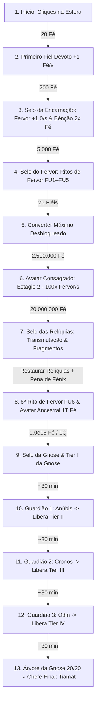

> **Registro histórico:** as durações e conclusões abaixo pertencem ao simulador simplificado anterior. Não validam os perfis atuais. O benchmark foi substituído por sessões, ações manuais e integração de 0,1 s. Use `npm run benchmark` e `Base/METODOLOGIA_CALCULO_PROGRESSAO.md` para a metodologia vigente.

# Análise de Balanceamento & Fluxo de Progressão — Cult of the Sphere

Este documento apresenta uma análise aprofundada de todos os sistemas de progressão atualmente implementados no jogo, mapeando a jornada do jogador desde o primeiro clique até a Ascensão Gnóstica, os **3 Guardiões Mitológicos** (Anúbis, Cronos e Odin) e o **Chefe Final de Endgame** (Tiamat), acompanhado das estimativas reais obtidas pelo simulador analítico (`ProgressionSimulator.ts`).

---

## 1. Fluxo Geral da Jornada do Jogador

A progressão do jogo segue uma estrutura linear de marcos (*Selos Sagrados*) associada a duas camadas de prestígio (**Relíquias / Opus Magnum** e **Câmara da Gnose**) e 4 **Chefes Mitológicos** calibrados para intervalos de **±30 minutos** entre cada chefe:

---

## 2. Linha do Tempo Real (Simulador Analítico `npm run benchmark`)

Tempos medidos deterministicamente pelo `ProgressionSimulator` desde o início do jogo até a derrota do **Chefe Final: Tiamat** para os 3 arquétipos de jogador:

| Marco de Progressão | Condição Principal | Ativo (Devoto) | Casual (Híbrido) | AFK (Ocioso) |
|---|---|---|---|---|
| **1º Fiel Devoto** | 20 Fé | **4s** | **10s** | **20s** |
| **Selo da Encarnação** | 200 Fé (Inicia Fervor 1/s) | **1m 08s** | **2m 12s** | **2m 15s** |
| **Selo do Fervor** | 5.000 Fé (Libera Ritos FU1–FU5) | **4m 15s** | **4m 24s** | **5m 31s** |
| **Avatar Consagrado (Est. 2)** | 2.500.000 Fé (100× Fervor/s) | **16m 05s** | **19m 48s** | **23m 47s** |
| **Selo das Relíquias** | 20.000.000 Fé | **17m 27s** | **22m 17s** | **24m 43s** |
| **1ª Transmutação Relíquias** | $\lfloor\log_2(\text{Fé}+1)\rfloor \ge 24$ Fragmentos | **17m 27s** | **22m 17s** | **24m 52s** |
| **Selo da Gnose** | $10^{15}$ Fé (`1Q`) | **1h 20m** | **1h 26m** | **1h 31m** |
| **1º Upgrade da Gnose** | $+1$ Gnose (`gn_init_faith`) | **1h 20m** | **1h 27m** | **1h 31m** |
| **Guardião 1: Anúbis (Tier II)** | Tier I completo ($\Delta_1 \approx 30\text{m}$) | **1h 46m** *(+26m)* | **1h 53m** *(+27m)* | **2h 07m** *(+36m)* |
| **Guardião 2: Cronos (Tier III)** | Tier II completo ($\Delta_2 \approx 30\text{m}$) | **2h 15m** *(+29m)* | **2h 29m** *(+36m)* | **2h 55m** *(+48m)* |
| **Guardião 3: Odin (Tier IV)** | Tier III completo ($\Delta_3 \approx 30\text{m}$) | **2h 43m** *(+28m)* | **3h 04m** *(+35m)* | **3h 37m** *(+42m)* |
| **Árvore da Gnose (20/20)** | Todos os 20 nós assimilados | **3h 11m** | **3h 39m** | **4h 23m** |
| **Chefe Final: Tiamat (Endgame)** | 20/20 Nós ($\Delta_4 \approx 30\text{m}$) | **3h 12m** *(+29m)* | **3h 40m** *(+36m)* | **4h 23m** *(+47m)* |

---

## 3. Análise Detalhada dos Sistemas

### 3.1. Início e Primeiros Fiéis (0 a 2 min)
- **Como está**: O jogador inicia com 1 Fé e 1 Fé por clique. Com 20 cliques (4s a 20s dependendo da cadência), recruta o primeiro Fiel Devoto (+1 Fé/s).
- **Curva de Custo**: A fórmula é $\lfloor 20 \times \text{escala}^N \times \text{descontoConquistas} \rfloor$, onde a escala base é `1.10` (reduzida em `-0.005` por nível do *Cajado de Hermes*, até `1.075`).
- **Veredito**: Ritmo inicial fluido (*early hook*), recompensando cliques ativos e desbloqueando as primeiras conquistas (`Primeiro Contato`, `Primeiro Converso`).

### 3.2. Encarnação Sagrada (Estágios 1 a 5)
- **Desbloqueio**: O **Selo da Encarnação** custa `200 Fé`, inicia o **Fervor** (`1.0/s` base) e libera o **Altar da Encarnação**.
- **Bênção 2× Fé**: Clicar no Altar da Encarnação adiciona `+2s` de **2× Fé/s** (até `60s` acumulados).
- **Duplo Papel da Encarnação**:
  1. **Multiplica a geração de Fervor/s** conforme o estágio atual:
     - **Estágio 1 (*Avatar Neófito*)**: Custo `0 Fé` → **1× Fervor/s**
     - **Estágio 2 (*Avatar Consagrado*)**: Custo `2.5M Fé` → **100× Fervor/s**
     - **Estágio 3 (*Avatar Ancestral*)**: Custo `1T Fé` (`1e12`) → **10.000× Fervor/s**
     - **Estágio 4 (*Avatar do Eclipse*)**: Custo `1e25 Fé` → **10⁸× Fervor/s**
     - **Estágio 5 (*Avatar Solar*)**: Custo `1e150 Fé` → **10¹⁵× Fervor/s**
  2. **Canaliza o Fervor acumulado para multiplicar os Fiéis Devotos**:
     $$\text{Mult}_{\text{EncarnaçãoFiéis}} = 1 + \log_{10}\left(1 + \frac{\text{Fervor}}{150}\right) \times 1.5 \times \text{Estágio}$$
     *(Triplicado por $3\times$ com o upgrade gnóstico Olho de Trismegisto).*

### 3.3. Ritos de Fervor (Fórmulas Oficiais DodecaDragons)
- **Desbloqueio**: **Selo do Fervor** por `5.000 Fé`. Revela 5 melhorias iniciais e um 6º rito desbloqueado pela *Pena Solar de Fênix*:
  1. `fu_prod` (Custo base 50 Fervor, ×1.8): $2^{\text{Nível}^{0.6}}$ multiplicando Fervor/s (evolui para $3.5^{\text{Nível}^{0.7}}$ com `gn_fu1_boost`).
  2. `fu_effect` (Custo base 100 Fervor, ×2.0): $1.25^{\text{Nível}^{0.8}}$ multiplicando o bônus passivo de Fervor na Fé:
     $$\text{Bônus} = \left(\log_{10}\left(\frac{\text{Fervor}}{10} + 1\right) \times 2 + 1\right) \times 1.25^{\text{Nível}^{0.8}}$$
  3. `fu_click` (Custo base 100 Fervor, ×1.4): $(\text{Nível}^{2.6} \times 4) + 1$ multiplicando a Fé por clique.
  4. `fu_followers` (Custo base 500 Fervor, ×1.5): $\left(\frac{\text{Nível}^{1.5} \times \text{Fiéis}}{50}\right) + 1$ multiplicando a produção dos Fiéis.
  5. `fu_synergy` (Custo base 500 Fervor, ×2.5): $\left(\frac{\text{Nível}^{1.5} \times \log_{10}(\text{Fé} + 1)}{5}\right) + 1$ multiplicando o Fervor/s (multiplicado por $5\times$ com `gn_synergy_boost`).
  6. `fu_relics` (Custo base 20.000.000 Fervor, ×5.0 — *revelado pela Pena Solar de Fênix*): $3^{\text{Nível}^{0.6}}$ multiplicando o ganho de Fragmentos nas Transmutações.

### 3.4. Relíquias e Transmutação (Meta: 20.000.000 Fé)
- **Desbloqueio**: **Selo das Relíquias** com `20.000.000 Fé` (`2e7`).
- **Transmutação**: $\lfloor\log_2(\text{Fé} + 1) \times \text{MultFragmentos}\rfloor$. Aos `20M Fé`, rende **24 Fragmentos** base.
- **Geração Passiva**: $\max(1, \lfloor \text{melhorTransmutação} / 10 \rfloor)$ Fragmentos/s, mais bônus percentuais da transmutação atual por segundo (*Anel Divino de Draupnir* `+5%/s`, *Cripta Eterna* `+25%/s`, *Transmutação Espontânea* `+100%/s`).

### 3.5. Câmara da Gnose, Árvore Hermética & Guardiões Mitológicos (Meta: 1Q / $10^{15}$ Fé)
- **Desbloqueio**: **Selo da Gnose** com `1e15 Fé`.
- **Fórmula de Ganho**:
  $$\text{Gnose} = \lfloor (\text{Fé} / 10^{15})^{0.15} \times \text{MultGnose} \rfloor$$
- **Multiplicador Passivo Permanente**:
  $$\text{Mult}_{\text{TotalGnose}} = 1 + \text{TotalGnose}^{0.35} \times 1.5$$
  *(Multiplicado por $1.5\times$ adicional com `gn_omniscience`).*
- **Árvore de 20 Nós (4 Tiers) e 4 Chefes Mitológicos (~30m por Tier)**:
  - **Tier I (`cost: 1..3`) → Guardião 1: Anúbis (Mitologia Egípcia, `1e18` HP)**: Multiplica Fé/s por 8×, Fervor/s por 3×, Fragmentos por 3,5× (`gn_init_faith`) e mantém Selos abertos com +50% Fragmentos (`gn_memoria_selos`), levando ~26m–36m até subjugar Anúbis e liberar o Tier II (+50% Fé/Fervor).
  - **Tier II (`cost: 10..150`) → Guardião 2: Cronos (Mitologia Grega, `5e28` HP)**: Introduz sinergia de Fiéis `1 + Fiéis^1.5` (`gn_followers_syn`), preservação de Relíquias (`gn_keep_relics`), Bênção perpétua (`gn_bencao_eterna`) e ressonância do Altar (`gn_altar_resonance`), levando ~29m–36m até subjugar Cronos e liberar o Tier III (+50% Fé/Fervor).
  - **Tier III (`cost: 170..9900`) → Guardião 3: Odin (Mitologia Nórdica, `1e38` HP)**: Evolui para sinergia cúbica `1 + Fiéis^3` (`gn_followers_cubic`), 2,5× Gnose (`gn_gnose_mult`), Fogo Hermético `3.5^(n^0.7)` (`gn_fu1_boost`), Forja Cósmica (`gn_synergy_boost`) e Harmonia Planetária (`gn_relic_resonance`), levando ~28m–35m até subjugar Odin e liberar o Tier IV (+50% Fé/Fervor).
  - **Tier IV (`cost: 14700..45800`) → Chefe Final: Tiamat (Mitologia Mesopotâmica, `1e42` HP)**: Desbloqueia Visão Panóptica (`gn_omniscience`), automações de Fiéis, Ritos de Fervor e Transmutações (`gn_auto_followers`, `gn_auto_fervor`, `gn_auto_relics`) e a Gnosis Suprema (`gn_apotheosis`), levando ~29m–36m até completar os 20/20 nós e derrotar Tiamat (*Crepúsculo dos Deuses*, 10× Fé/Fervor).
