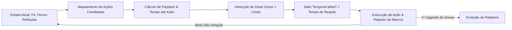

# Metodologia de Cálculo do Relatório de Progressão — Cult of the Sphere

Este documento descreve detalhadamente o funcionamento interno, premissas matemáticas, perfis comportamentais e algoritmos utilizados pelo **Simulador Analítico Headless** (`ProgressionSimulator.ts`) para gerar o Relatório de Progressão (`npm run benchmark` e botão no `TestMenu`).

---

## 1. Visão Geral da Arquitetura do Simulador

O benchmark opera sob o paradigma de **Salto Temporal por Evento (Event-Jumping / Fast-Forward)**. Ao invés de processar o laço de jogo tick a tick (o que exigiria bilhões de iterações para simular horas de jogo), o motor calcula analiticamente o tempo exato necessário para que a próxima ação válida se torne viável e salta o estado para esse ponto no tempo com 100% de precisão matemática.



### Premissas Fundamentais:
1. **Sem Ganhos Offline com Aba Fechada**: O simulador replica o comportamento de um jogador com o jogo aberto na aba (foreground/background da janela ativa).
2. **Respeito Estrito às Fórmulas Canônicas**: O simulador importa diretamente o `GameStateManager` e as funções matemáticas de `src/systems/calculations.ts`.

---

## 2. Parâmetros dos Perfis Comportamentais (Arquétipos)

Para avaliar o balanceamento do jogo sob diferentes estilos de jogadores, o modelo define 3 arquétipos fundamentais com valores explícitos de **cliques por segundo (CPS)**, **tempo de reação/decisão humano** e **manutenção de buffs ativos**.

| Parâmetro | Devoto Fervoroso (Ativo) | Devoto Regular (Casual/Híbrido) | Ocioso Puro (AFK) |
|---|---|---|---|
| **Cadência de Cliques Inicial (CPS)** | **5.0 cliques/s** (200ms por clique) | **2.0 cliques/s** (500ms por clique) | **1.0 clique/s** (1000ms por clique) |
| **Tempo até 1º Fiel (20 Fé)** | **4.0 segundos** | **10.0 segundos** | **20.0 segundos** |
| **Comportamento Pós-Primeiro Fiel** | Mantém cliques estratégicos e ativos | Cessa cliques na Esfera, foca em compras | **Zero cliques na Esfera** (100% passivo) |
| **Tempo Médio de Reação à Compra** | **3.0 segundos** (atenção focada) | **5.0 segundos** (atenção dispersa/híbrida) | **0.0 segundos** (analítico por lote de espera) |
| **Manutenção da Bênção do Avatar (2x Fé)** | **100% ativa** (renova a cada 60s) | Ocasional / Inconstante | **Nunca ativada** (0s de bênção manual) |
| **Frequência de Checagem do Jogo** | Contínua (tempo real na tela) | Sessões intercaladas com pausas de 5-15m | Sessões espaçadas de 30m a 2h |
| **Estratégia de Compra** | Greedy por menor ROI / Tempo de Retorno | Híbrida (Desbloqueios + mais baratos) | Compra em lote quando há saldo elevado |

> **Nota sobre o Tempo de Reação**: Quando um upgrade se torna acessível ($\text{tempoNecessário} > 0$), o jogador humano não clica no milissegundo exato em que a moeda atinge o valor da compra. O simulador adiciona o tempo de reação humano ($3.0\text{s}$ para Ativo e $5.0\text{s}$ para Casual) ao tempo de acumulação do recurso, tornando a projeção realista.

---

## 3. Algoritmo de Decisão e Priorização de Ações

A cada etapa da simulação, o motor avalia todas as opções disponíveis no catálogo do jogo e monta uma lista de ações candidatas ponderadas por prioridade:

$$\text{tempoParaAcumular} = \max\left(0, \frac{\text{Custo} - \text{Saldo Atual}}{\text{Taxa de Geração por Segundo}}\right)$$

$$\text{tempoEsperaTotal} = \text{tempoParaAcumular} + (\text{tempoParaAcumular} > 0 \ ? \ \text{tempoReação} : 0)$$

### Hierarquia de Prioridades (Ordem de Execução):
1. **Prioridade 1 — Desbloqueio de Mecânicas (Selos Sagrados)**:
   - Se o próximo Selo sequencial (`unlock_incarnation`, `unlock_fervor_upgrades`, `unlock_relics`, `unlock_gnose`) for atingível em tempo razoável (< 3 minutos), ele recebe prioridade máxima sobre micro-upgrades.
2. **Prioridade 2 — Estágios da Encarnação (Avatar)**:
   - Apenas avaliado se for alcançável em menos de 30 minutos de geração contínua, multiplicando drasticamente o Fervor.
3. **Prioridade 3 — Recrutamento de Fiéis Devotos**:
   - Compra via `buyMaxFollowers` se a função Converter Máximo estiver liberada (25 fiéis ou upgrade de Gnose); caso contrário, compra de 1 em 1.
4. **Prioridade 4 — Ritos de Fervor (Upgrades de Fervor)**:
   - Ordenados pelo menor tempo de espera em relação à taxa atual de Fervor/s (`fu_prod`, `fu_effect`, `fu_click`, `fu_followers`, `fu_synergy`).
5. **Prioridade 5 — Restauração de Relíquias (Upgrades de Fragmentos)**:
   - Compra dos artefatos mitológicos (`relic_cornucopia`, `relic_torch`, `relic_phoenix`, `relic_caduceus`, `relic_draupnir`, `relic_ark`) respeitando os níveis máximos.

---

## 4. Regras e Gatilhos de Prestígio

### 4.1. Transmutação de Relíquias (Prestige Secundário)
O reset de Fé para Fragmentos de Relíquias é disparado quando:
1. O rendimento da Transmutação atual for $\ge 15$ Fragmentos; **E**
2. O ganho projetado superar o dobro do saldo atual ($P_{\text{ganho}} \ge 1.5 \times P_{\text{atual}}$) ou for a 1ª transmutação ($P_{\text{atual}} = 0$).

Fórmula de ganho:
$$\text{Fragmentos} = \lfloor \log_2(\text{Fé} + 1) \times \text{MultiplicadorRelíquias} \rfloor$$

### 4.2. Despertar Gnóstico (True Prestige / Reset Supremo)
O reset de Gnose é disparado assim que o valor acumulado no reset atual for suficiente para adquirir pelo menos **1 upgrade na Câmara da Gnose**:
$$\text{Gnose Ganha} = \lfloor (\text{Fé} / 10^{15})^{0.15} \times \text{MultGnose} \rfloor \ge 1$$
Ao atingir $1$ Ponto de Gnose, a simulação executa `performGnoseReset()`, adquire o primeiro upgrade da árvore (*Emanaçāo Primordial - Centelha do Nous*, que concede 5x Fé global e início com 1.000 Fé) e finaliza o ciclo de medição.

---

## 5. Detecção de Zonas Mortas (Dead Zones)

Uma **Zona Morta** é definida como um intervalo de tempo contínuo onde o jogador não possui nenhuma compra, upgrade ou decisão viável para tomar, sendo obrigado a esperar de forma ociosa.

Os limiares de tolerância são escalonados de acordo com a maturidade da fase de jogo:

| Fase de Jogo | Condição de Estado | Limiar Máximo de Tolerância | Justificativa de UX |
|---|---|---|---|
| **Early Game** | Até quebrar o Selo da Encarnação | **5 minutos (300 segundos)** | Esperas longas no início causam abandono imediato do jogo. |
| **Mid Game** | Da Encarnação até o Selo da Gnose | **20 minutos (1.200 segundos)** | Fase de expansão rítmica com ciclos de ritos e relíquias. |
| **Late Game / Pré-Gnose** | Do Selo da Gnose até o 1º Reset | **2 horas (7.200 segundos)** | Etapa de acúmulo sub-exponencial típica do endgame. |

Se qualquer salto temporal superar o limiar da sua respectiva fase, o evento é registrado no array `deadZones[]` com o tempo excedente, o upgrade que causou a lentidão e o diagnóstico do gargalo.

---

## 6. Classificação e Diagnóstico de Balanceamento

O resultado de cada arquétipo recebe uma pontuação diagnóstica sintética baseada na estabilidade da progressão:

- **Excelente**: 0 Zonas Mortas detectadas, tempo total até Gnose $< 2$ horas e espera máxima entre upgrades $< 5$ minutos.
- **Balanceado**: 0 Zonas Mortas críticas, tempo total até Gnose $< 3$ dias e espera máxima $< 30$ minutos.
- **Lento**: Pelo menos 1 Zona Morta pontual detectada ou espera máxima superior a 1 hora.
- **Gargalo Crítico**: Mais de 3 Zonas Mortas detectadas ou espera ininterrupta sem compras superior a 4 horas.

---

## 7. Acoplamento com as Fórmulas do Jogo (FAQ)

### "Quando eu alterar alguma fórmula do jogo, eu preciso alterar o simulador?"

**Na imensa maioria das vezes, NÃO!** 
O simulador foi desenhado com arquitetura de acoplamento direto via `GameStateManager`:

1. **Alterações Automáticas (Zero manutenção no benchmark)**:
   - Se você alterar constantes e fórmulas em `src/systems/calculations.ts` (ex: expoente de fé, logaritmo de relíquias, fórmula de gnose).
   - Se você alterar os custos de fé, fervor, relíquias ou bônus nos arquivos `src/config/followers.ts`, `src/config/fervor.ts`, `src/config/incarnation.ts`, `src/config/relics.ts`, `src/config/gnose.ts`, `src/config/unlocks.ts`.
   - Se você alterar multiplicadores e taxas em `GameState.ts` (`getFaithPerSecond()`, `getFervorRatePerSecond()`, etc.).
   
   👉 **O benchmark recalcula tudo automaticamente** no próximo `npm run benchmark`, refletindo instantaneamente as novas curvas e novos tempos!

2. **Quando VOCÊ PRECISA alterar o simulador**:
   - **Adição de uma mecânica ou moeda inteiramente nova** (ex: se criar um sistema de "Almas", "Pactos" ou "Templos" com sua própria moeda e aba).
   - **Mudança na regra de vitória/marco final** (ex: se o objetivo final deixar de ser comprar o 1º upgrade de Gnose e passar a ser completar o Pantheon ou atingir 10 resets).
   - **Mudança de pré-requisitos lógicos estruturais** (ex: se um upgrade passar a exigir um mini-game interativo específico).

---

## 8. Como Executar e Auditar

### No Terminal:
```bash
npm run benchmark
```
Executa a simulação completa para os 3 perfis e imprime a tabela comparativa estruturada no console.

### No Navegador:
1. Inicie o jogo (`npm run dev`) e abra a aplicação.
2. Pressione a tecla `[T]` ou `[F2]` para abrir o **Painel de Testes do Culto**.
3. Na Seção 4 (*Medição Definitiva de Progressão*), clique no botão **⚡ Simular Curva de Progressão (Ativo vs Casual vs AFK)**.
4. A tabela de marcos, tempos acumulados, contagem de resets e diagnósticos será renderizada instantaneamente na interface.
