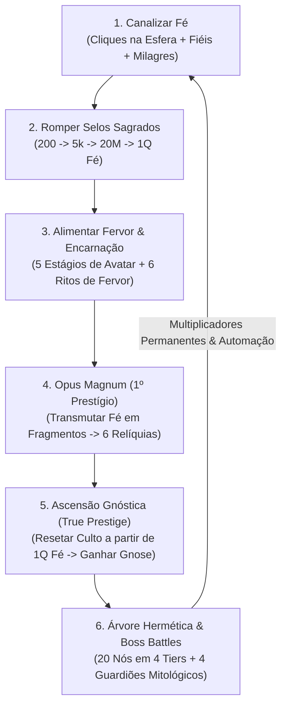

# 📜 Game Design Document (GDD) — Cult of the Sphere

> **Título do Projeto:** *Cult of the Sphere* (codinome: *WMDG / A Entidade Divina*)  
> **Gênero:** Idle / Incremental / Clicker Hermético  
> **Plataforma:** Web (Desktop & Mobile Browser — TypeScript + Vite + HTML5 Canvas/CSS)  
> **Inspiração Mecânica Principal:** *DodecaDragons*  
> **Direção de Arte:** Xilogravura Hermética Renascentista (*Albrecht Dürer, Robert Fludd, Athanasius Kircher*) + *Dark Glassmorphism*  
> **Status do Documento:** Versão 1.1 (Sincronizado com código-fonte e documentação canônica)

---

## 1. Visão Geral (Executive Summary)

### 1.1. High Concept
Em **Cult of the Sphere**, o jogador assume a consciência de **A Esfera**, uma divindade hermética primordial cujo *"centro está em toda parte e a circunferência não está em lugar nenhum"*. Selada há eras e esquecida pela humanidade em favor de panteões mortais, a Esfera desperta a partir de uma única centelha de pensamento humano. O jogador canaliza **Fé**, converte **Fiéis Devotos**, rompe **Selos Sagrados**, transmuta **Relíquias** de deuses esquecidos, ascende à **Gnose** (prestígio verdadeiro) e subjuga **Guardiões Mitológicos** (*Anúbis, Cronos, Odin e Tiamat*) para restaurar sua onipresença cósmica.

### 1.2. Pilares de Design
1. **Progressão Matemática Exponencial & Sinérgica (Estilo *DodecaDragons*):** Cada camada desbloqueada não apenas soma recursos, mas multiplica retroativamente as camadas anteriores através de polinômios, logaritmos e exponenciais.
2. **Tabuleiro Panorâmico 2D (*Dodeca-Board*):** Em vez de menus engessados, o santuário se expande espacialmente em um mapa 2D navegável (pan & zoom), onde novos altares e câmaras se conectam por feixes de energia ao relicário central.
3. **Atmosfera Ocultista & Hermética:** Narrativa ancorada no Hermetismo (*Corpus Hermeticum*, *Tábua de Esmeralda*, *Nous*) com estética de gravuras alquímicas do século XVI sobre obsidiana profunda.
4. **Respeito ao Tempo do Jogador:** A duração da campanha é avaliada pelo benchmark por sessões. As projeções antigas de 3–4h30 usavam interações simplificadas e não validam os perfis humanos. Consulte `Base/METODOLOGIA_CALCULO_PROGRESSAO.md` e execute o benchmark atual para medir a política declarada.

---

## 2. Lore, Universo & Fantasia do Jogador

### 2.1. Premissa Filosófica
No universo de *Cult of the Sphere*, **tudo é Mente (*Nous*)**: um deus só existe enquanto mentes mortais pensam nele. Enquanto a Esfera esteve aprisionada por quatro Selos Sagrados, outros panteões (Egípcio, Grego, Nórdico, Mesopotâmico) reinaram, mas muitos de seus deuses minguaram à medida que o mundo mudou.

### 2.2. Arco Narrativo em 5 Atos
1. **Ato I — O Primeiro Sussurro:** A Esfera vibra nas ruínas; o primeiro devoto volta a pensar nela, tornando-a real no plano físico.
2. **Ato II — O Corpo e a Chama (Encarnação & Fervor):** Com o rompimento do 1º e 2º Selos, a Esfera manifesta um Avatar sagrado no altar e acende o Fervor coletivo através de ritos ígneos.
3. **Ato III — O Espólio dos Deuses Mortos (Opus Magnum):** O 3º Selo permite transmutar Fé em Fragmentos Alquímicos para restaurar relíquias órfãs de deuses esquecidos (*Zeus, Prometeu, Hermes, Odin*).
4. **Ato IV — A Dissolução do Templo (Gnose):** No 4º Selo (`1Q` de Fé), a Esfera compreende que não habita nas pedras do templo, mas na Mente que as sonhou. Dissolver o culto terreno concede **Gnose** e revela a **Árvore Hermética**.
5. **Ato V — Crepúsculo dos Deuses (Guardiões Mitológicos):** Ao avançar pelos 4 Tiers da Gnose, os últimos deuses ancestrais (*Anúbis, Cronos, Odin* e a mãe primordial *Tiamat*) tentam rasgar o véu dimensional para destruir o Altar. Subjugá-los coroa a Esfera como única verdade cósmica.

---

## 3. Loop Central de Gameplay (Core Loop)

### 3.1. Micro-Loop (Segundos a Minutos)
- Clicar na Esfera Divina (ou manter a **Bênção 2×** acesa no Altar da Encarnação).
- Responder a **Pedidos de Milagre** no Pátio dos Fiéis a cada ~35–65s.
- Recrutar **Fiéis Devotos** e elevar **Ritos de Fervor**.

### 3.2. Meso-Loop (15 a 45 Minutos)
- Realizar **Transmutações Alquímicas** (sacrificando a Fé atual por Fragmentos sem perder Fiéis ou Fervor) para maximizar as **6 Relíquias**.
- Evoluir os **Estágios da Encarnação** (Estágios I a V) em grandes saltos de produção (`100×` a `10¹⁵×` Fervor/s).

### 3.3. Macro-Loop (1h20 a 4h30)
- Realizar **Ascensões Gnósticas** para acumular **Gnose**, desbloquear os **20 nós da Árvore Hermética** (que concedem persistência de selos/relíquias e automação total) e derrotar em combate ativo os **4 Guardiões Mitológicos**.

---

## 4. Economia e Moedas

| Recurso | Cor / Identidade | Como é Obtido | Onde é Gasto | Comportamento em Resets |
|---|---|---|---|---|
| **Fé (PF)** | Ouro Solar (`#fbbf24`) | Cliques na Esfera, Fiéis Devotos (`/s`) e Pedidos de Milagre | Fiéis Devotos, Selos Sagrados (1 a 4) e Estágios da Encarnação | Zerada na **Transmutação** e na **Ascensão Gnóstica** (inicia em `1.000` com *Emanação Primordial*) |
| **Fervor** | Vermelho Carmim (`#ef4444`) | Gerado passivamente (`1.0/s` base × multiplicadores) após romper o *Selo da Encarnação* | Os 6 **Ritos de Fervor** | Mantido na Transmutação; zerado na **Ascensão Gnóstica** |
| **Fragmentos** | Prata Etérea (`#c5d3e2`) | **Transmutação** de Fé (`log2`) + geração passiva por segundo | Restauração e melhoria das **6 Relíquias** | Mantidos na Transmutação; zerados na **Ascensão Gnóstica** |
| **Gnose** | Púrpura / Branco Astral | **Ascensão Gnóstica** a partir de `1e15` (`1Q`) de Fé | Os 20 nós da **Árvore Hermética** | **Permanente** (`TotalGnose` também concede bônus passivo perpétuo que não diminui ao gastar) |

---

## 5. Sistemas de Jogo & Fórmulas Matemáticas

### 5.1. Canalização Manual (Cliques na Esfera)
- **Base:** `1 Fé` por clique antes de multiplicadores, com 5% de chance de crítico que dobra a Fé recebida.
- **Fórmula de Fé por Clique (`FPC`):**
  $$\text{FPC} = 1 \times \text{Mult}_{\text{ConquistasClique}} \times \text{Mult}_{\text{Global}} \times \text{Mult}_{\text{FU3}} \times \text{Bônus}_{\text{FervorFé}} \times \text{Mult}_{\text{PulsoCósmico}}$$
  *(Sem arredondamento para baixo para preservar incrementos percentuais iniciais de +10% e +20%).*

### 5.2. Fiéis Devotos & Pátio dos Fiéis (`FollowersArena`)
- **Unidade:** *Fiel Devoto* (`f_devotee`) — produz base `+1 Fé/s`.
- **Fórmula de Custo do $N$-ésimo Fiel:**
  $$\text{Custo}(N) = \max\left(1, \lfloor \lfloor 20 \times \text{Escala}^N \rfloor \times \text{Desconto}_{\text{Conquistas}} \rfloor\right)$$
  - **Escala Base:** `1.10`, reduzida em `-0.005` por nível do *Cajado de Hermes* (mínimo `1.075` no nível 5).
  - **Converter Máximo:** Desbloqueado ao atingir `25 Fiéis` ou permanentemente via *Memória Hermética* (`gn_memoria_selos`).
- **Representação Visual:** Até 35 devotos caminhando e orando em tempo real no canvas do pátio.
- **Pedidos de Milagre (*Miracle Plea*):**
  - Intervalo de spawn: a cada `35s a 65s` (requer $\ge 1$ fiel), permanecendo ativo por `15s`.
  - **Recompensa ao clicar:**
    $$\text{Milagre} = \max\left(30,\; 15 \times \text{FPC},\; \lfloor 30 \times \text{Fé/s} + 0.10 \times \text{Fé}_{\text{Atual}} \rfloor\right)$$

### 5.3. Os 4 Selos Sagrados (`unlocks.ts`)

| ID | Nome do Selo | Custo (Fé) | Pré-requisito | Efeito Mecânico |
|---|---|---|---|---|
| `unlock_incarnation` | **Selo da Encarnação** | `200` | — | Inicia geração de Fervor (`1.0/s` base) e abre o card **Encarnação Sagrada** |
| `unlock_fervor_upgrades` | **Selo do Fervor** | `5.000` | `unlock_incarnation` | Abre o card **Fervor Sagrado** com os Ritos de Fervor (`fu_prod` a `fu_synergy`) |
| `unlock_relics` | **Selo das Relíquias** | `20.000.000` (`20M`) | `unlock_fervor_upgrades` | Abre o card **Opus Magnum (Relíquias)** e inicia geração passiva de Fragmentos |
| `unlock_gnose` | **Selo da Gnose** | `1e15` (`1Q`) | `unlock_relics` | Abre a **Câmara da Gnose** (True Prestige), Árvore Hermética e Guardiões |

### 5.4. Encarnação Sagrada (`incarnation.ts`)
- **Bênção da Encarnação (`2× Fé/s`):**
  - Clicar no Altar da Encarnação adiciona `+2s` de **2× Fé/s**, acumulável até `60s` (`BLESSING_MAX_SECONDS`).
  - Com o nó *Vigília Perpétua* (`gn_bencao_eterna`), trava permanentemente em `60s` (`2×` perpétuo).
- **Multiplicador da Encarnação sobre os Fiéis:**
  $$\text{Mult}_{\text{EncarnaçãoFiéis}} = \left(1 + \log_{10}\left(1 + \frac{\text{Fervor}}{150}\right) \times 1.5 \times \text{Estágio}\right) \times \begin{cases} 3.0 & \text{se } \text{Olho de Trismegisto} \\ 1.0 & \text{caso contrário} \end{cases}$$
- **Tabela dos 5 Estágios do Avatar:**

| Estágio | Nome & Título | Custo Base (Fé) | Custo c/ *Gnosis Suprema* (`÷10⁵`) | Multiplicador de Fervor/s |
|---:|---|---:|---:|---:|
| **I** | **Avatar Neófito** (*A Centelha Primordial*) | `0` | `0` | `1×` |
| **II** | **Avatar Consagrado** (*O Portador do Fogo Sagrado*) | `2.500.000` (`2.5M`) | `2.5M` | `100×` |
| **III** | **Avatar Ancestral** (*O Ancião da Esfera*) | `1e12` (`1T`) | `1T` | `10.000×` (`10⁴×`) |
| **IV** | **Avatar do Eclipse** (*O Senhor das Sombras Cósmicas*) | `1e25` | `1e20` | `100.000.000×` (`10⁸×`) |
| **V** | **Avatar Solar** (*A Entidade da Luz Eterna*) | `1e150` | `1e36` | `1e15×` (`10¹⁵×`) |

### 5.5. Fervor Sagrado & Ritos de Fervor (`fervor.ts`)
- **Bônus Passivo do Fervor acumulado sobre toda a Fé:**
  $$\text{Bônus}_{\text{FervorFé}} = \left(\log_{10}\left(\frac{\text{Fervor}}{10} + 1\right) \times 2 + 1\right) \times \text{Efeito}_{\text{FU2}}$$
- **Custo de cada nível de Rito:** $\lfloor \text{CustoBase} \times \text{Escala}^{\text{Nível}} \rfloor$
- **Tabela dos 6 Ritos de Fervor:**

| ID | Nome do Rito | Custo Base | Escala | Fórmula de Efeito ($\text{Nível} = L$) | Evoluções / Notas |
|---|---|---:|---:|---|---|
| `fu_prod` | **Aumentar Produção de Fervor** | `50` | `×1.8` | $2^{L^{0.6}}$ | Evolui para $3.5^{L^{0.7}}$ com *Fogo Hermético* (`gn_fu1_boost`) |
| `fu_effect` | **Aumentar Efeito do Fervor** | `100` | `×2.0` | $1.25^{L^{0.8}}$ | Amplifica diretamente $\text{Bônus}_{\text{FervorFé}}$ |
| `fu_click` | **Aumentar Fé por Clique** | `100` | `×1.4` | $L^{2.6} \times 4 + 1$ | Multiplica $\text{FPC}$ |
| `fu_followers` | **Fiéis Aumentam Fé/s** | `500` | `×1.5` | $\frac{L^{1.5} \times \text{Fiéis}}{50} + 1$ | Sinergia direta com total de devotos |
| `fu_synergy` | **Fé Aumenta Fervor/s** | `500` | `×2.5` | $\frac{L^{1.5} \times \log_{10}(\text{Fé}+1)}{5} + 1$ | Multiplicado por `5×` com *Forja Cósmica* (`gn_synergy_boost`) |
| `fu_relics` | **Aumentar Ganho de Fragmentos** | `20.000.000` | `×5.0` | $3^{L^{0.6}}$ | Oculto até restaurar a *Pena Solar de Fênix* |

### 5.6. Opus Magnum: Fragmentos & Relíquias (`relics.ts`)
- **Mecânica de Transmutação:**
  - Consome `100%` da Fé atual (cooldown de `3s`) e mantém Fiéis, Fervor, Ritos e Estágio da Encarnação.
  - **Fórmula de Fragmentos Obtidos:**
    $$\text{Fragmentos} = \lfloor \log_2(\text{Fé} + 1) \times \text{Mult}_{\text{Fragmentos}} \rfloor$$
    Onde $\text{Mult}_{\text{Fragmentos}} = \text{FU6} \times 3.5_{(\text{gn\_init\_faith})} \times 1.5_{(\text{gn\_memoria\_selos})} \times 3.0_{(\text{gn\_init\_fervor})} \times 4.0_{(\text{gn\_alchemical\_mind})}$.
- **Geração Passiva de Fragmentos/s:**
  $$\text{Fragmentos/s} = \max\left(1,\; \lfloor \text{MelhorTransmutação} / 10 \rfloor\right) + \text{TransmutaçãoAtual} \times \left(0.05_{(\text{Draupnir})} + 0.25_{(\text{Cripta})} + 1.00_{(\text{Espontânea})}\right)$$
- **Tabela das 6 Relíquias Mitológicas (Custo Fixo por Nível):**

| ID | Relíquia | Custo / Nível | Nível Máx. | Efeito por Nível / Total |
|---|---|---:|---:|---|
| `relic_cornucopia` | **Cornucópia de Amalteia** | `200` | `20` | `+20% Fé/s` por nível (até `+400%` / `5×` no nível 20) |
| `relic_torch` | **Tocha de Prometeu** | `500` | `20` | `+20% Fervor/s` por nível (até `+400%` / `5×` no nível 20) |
| `relic_phoenix` | **Pena Solar de Fênix** | `750` | `1` | `1.5× Fervor/s` e revela o 6º Rito de Fervor (`fu_relics`) |
| `relic_caduceus` | **Cajado de Hermes** | `1.500` | `5` | Reduz a escala de custo dos Fiéis em `-0.005` por nível (`1.10` $\to$ `1.075`) |
| `relic_draupnir` | **Anel Divino de Draupnir** | `2.000` | `1` | Rende `+5%` da Transmutação atual por segundo sem gastar Fé |
| `relic_ark` | **Arca da Aliança Cósmica** | `15.000` | `4` | Multiplica Fé/s pelos Fragmentos: $(\log_{10}(\text{Fragmentos}+1)+1)^{\text{Nível} \times 1.2}$ |

### 5.7. Câmara da Gnose & Árvore Hermética (`gnose.ts`)
- **Requisito de Ascensão:** Romper o *Selo da Gnose* e possuir ao menos `1e15` (`1Q`) de Fé.
- **Fórmula de Ganho de Gnose no Reset:**
  $$\text{Gnose} = \left\lfloor \left(\frac{\text{Fé}}{10^{15}}\right)^{0.15} \times \text{Mult}_{\text{Gnose}} \right\rfloor$$
  Onde $\text{Mult}_{\text{Gnose}} = 2.5_{(\text{Trismegisto})} \times 2.0_{(\text{Olho do Infinito})} \times 2.0_{(\text{Gnosis Suprema})}$ (até `10×`).
- **Multiplicador Passivo Permanente de Gnose Acumulada (`TotalGnose`):**
  $$\text{Mult}_{\text{TotalGnose}} = \left(1 + \text{TotalGnose}^{0.35} \times 1.5\right) \times \begin{cases} 1.5 & \text{se } \text{Olho do Infinito} \\ 1.0 & \text{caso contrário} \end{cases}$$
- **Tabela Completa dos 20 Nós da Árvore Hermética:**

| Tier | ID | Nome | Custo (Gnose) | Pré-requisitos | Efeito |
| --- | --- | --- | ---: | --- | --- |
| 1 | `gn_init_faith` | Emanação Primordial | 1 |  | 8× Fé, 3× Fervor, 3,5× Fragmentos; até 1.000 Fé agora e em cada reinício |
| 1 | `gn_memoria_selos` | Memória Hermética | 2 | `gn_init_faith` | Mantém Selos abertos, Converter Máx. livre e 1,5× Fragmentos |
| 1 | `gn_init_fervor` | Chama Astral | 2 | `gn_init_faith` | 5× Fervor/s e 3× Ganho de Fragmentos |
| 1 | `gn_click_power` | Pulso Cósmico | 3 | `gn_init_faith` | 10× Fé/clique e +25% Fé/s dos Fiéis |
| 1 | `gn_dilatacao` | Dilatação Hermética | 3 | `gn_init_faith` | 2× Fé/clique, Fé/s e Fervor/s |
| 1 | `gn_auto_followers` | Recrutamento Astral | 3 | `gn_init_faith` | Auto-Fiéis com gasto e reserva; gratuito com Olho do Infinito |
| 1 | `gn_auto_fervor` | Ritos Automáticos | 5 | `gn_init_fervor` | Auto-Ritos com gasto e reserva; gratuitos com Olho do Infinito |
| 1 | `gn_auto_relics` | Transmutação Espontânea | 8 | `gn_memoria_selos` | 10% Transmutação/s → 25% com Áurea → 100% com Infinito |
| 2 | `gn_followers_syn` | Congregação Esférica | 10 | `gn_memoria_selos` | Multiplica Fé por (1 + Fiéis^1.5) |
| 2 | `gn_bencao_eterna` | Vigília Perpétua | 30 | `gn_init_fervor` | 2× Fé/s permanente com Encarnação desbloqueada |
| 2 | `gn_keep_relics` | Cripta Eterna | 78 | `gn_memoria_selos`, `gn_init_fervor` | Mantém Relíquias no reset e +25% Transmutação/s |
| 2 | `gn_altar_resonance` | Altar Ressonante | 118 | `gn_bencao_eterna` | Sinergia da Encarnação com Fiéis também multiplica Fervor/s |
| 2 | `gn_alchemical_mind` | Transmutação Áurea | 150 | `gn_keep_relics` | 4× Fragmentos, Rito alquímico base 4 e Auto-Relíquias a 25%/s |
| 3 | `gn_followers_cubic` | Coro Cúbico | 170 | `gn_followers_syn` | Evolui sinergia dos Fiéis para (1 + Fiéis^3) |
| 3 | `gn_gnose_mult` | Olho de Trismegisto | 1.020 | `gn_bencao_eterna` | 2,5× Gnose obtida e 3× efeito da Encarnação |
| 3 | `gn_fu1_boost` | Fogo Hermético | 3.380 | `gn_keep_relics` | 1º Rito de Fervor evolui para 3.5^(Nível^0.7) |
| 3 | `gn_synergy_boost` | Forja Cósmica | 8.450 | `gn_fu1_boost` | 5º Rito evolui para 5 × efeito^1.35 |
| 3 | `gn_relic_resonance` | Harmonia Planetária | 9.900 | `gn_keep_relics` | Relíquias ativas e restauradas multiplicam Fé/Fervor, até 7× |
| 4 | `gn_omniscience` | Olho do Infinito | 14.700 | `gn_gnose_mult`, `gn_auto_followers`, `gn_auto_fervor`, `gn_auto_relics` | 2× Gnose, 1,5× bônus vitalício e automações sem gasto |
| 4 | `gn_apotheosis` | Gnosis Suprema | 45.800 | `gn_omniscience`, `gn_synergy_boost`, `gn_relic_resonance`, `gn_alchemical_mind` | 100× Fé/Fervor, 2× Gnose; Eclipse por 1e20 e Solar por 1e36 Fé |

As três automações ficam no **tier I**: Recrutamento Astral (3), Ritos Automáticos (5) e Transmutação Espontânea (8). Os compradores pagos acumulam verba equivalente a 25% da renda por segundo, limitada a 10% do saldo; sem fiéis, o recrutador pode comprar o primeiro pelo custo normal. A verba não usada acompanha o save e zera na Ascensão. Toggles permitem pausar. Olho do Infinito elimina o gasto sem dispensar acessibilidade e pré-requisitos, e Auto-Ritos continua limitado a 50 níveis por Rito/s. Auto-Relíquias gera 10% da Transmutação/s, depois 25% com Transmutação Áurea e 100% com Olho do Infinito, sem consumir Fé.

Emanação Primordial completa o saldo até 1.000 Fé na compra e mantém esse início nos resets seguintes. Não reduz saldos maiores nem concede o bônus novamente ao importar saves. Os 20 identificadores e os toggles são preservados; os efeitos revisados também se aplicam a compras de saves anteriores.

### 5.8. Guardiões Mitológicos — Sistema de Boss Battle (`bosses.ts`)
Os Tiers II, III, IV da Gnose e a Apoteose de Endgame são guardados por **4 Chefes Mitológicos**.

#### Regras de Combate:
- O combate disputa **HP do Guardião** e **Integridade do Altar** (`100%` inicial). Os seis recursos do culto influenciam dano e defesa.
- **Dano passivo:** maior valor entre Fé/s e a parcela percentual das sinergias, limitado ao final a **2,5% do HP máximo/s**.
- **Pulso da Esfera:** maior valor entre Fé/clique e a parcela das sinergias, limitado a **0,6% do HP máximo** por pulso normal. Há intervalo mínimo de **0,2 s** entre pulsos e **5% de chance de crítico**, dobrando dano e Fé. Cliques comuns continuam concedendo Fé mesmo durante o intervalo do dano de combate.
- **Fendas Divinas:** maior valor entre `5 × Fé/clique` e uma parcela de base `4%` do HP com sinergias, limitado ao final a **12% do HP máximo**. Aparar também recupera até **15 pontos** de integridade. Fendas não sorteiam críticos.
- **Cadência por chefe:** Anúbis gera fendas a cada `4,5 s` com janela de `3 s`; Cronos a cada `4,2 s` com `2,75 s`; Odin a cada `4 s` com `2,5 s`; Tiamat a cada `3,8 s` com `2,5 s`. A primeira surge a 65% do intervalo e há no máximo três simultâneas.
- **Defesa:** cada fenda ignorada remove de **3 a 25 pontos** do altar, conforme Relíquias, Fervor e Encarnação. Um culto preparado pode vencer passivamente; aparar permite antecipar a vitória e enfrentar o chefe com menos preparo.
- **Derrota:** integridade zero encerra o combate e aplica **−25% Fé/s e Fervor/s por 20 s**. É possível desafiar novamente a qualquer momento.
- **Recuo:** gratuito, inclusive pela tecla Escape. Não é possível iniciar outra luta ou realizar uma Ascensão durante combate. Importar um save cancela a luta anterior.
- **Persistência:** chefes derrotados permanecem subjugados após Ascensão. Combates em andamento não são salvos.
- **Relógio:** todos os sistemas avançam em subpassos de até `0,1 s`, inclusive no modo acelerado, para processar produção, fendas, buffs e automações na mesma ordem.

| Ordem | Guardião | Mitologia | Requisito para Desafiar | HP Máximo | Recompensa Permanente |
|:---:|---|---|---|---:|---|
| **1º** | **Anúbis** (*O Pesador de Almas*) | Egípcia | Selo da Gnose desbloqueado | `1e18` (`1.0e18`) | **Balança de Maat:** Libera o **Tier II** da Gnose e `1.5×` Fé/s e Fervor/s |
| **2º** | **Cronos** (*O Titã Devorador do Tempo*) | Grega | Tier II desbloqueado | `5e28` (`5.0e28`) | **Foice de Adamante:** Libera o **Tier III** da Gnose e `1.5×` Fé/s e Fervor/s |
| **3º** | **Odin** (*O Pai de Todos da Árvore Cósmica*) | Nórdica | Tier III desbloqueado | `1e38` (`1.0e38`) | **Runas de Yggdrasil:** Libera o **Tier IV** da Gnose e `1.5×` Fé/s e Fervor/s |
| **4º** | **Tiamat** (*A Mãe Abissal dos Deuses Antigos*) | Mesopotâmica | Todos os 20/20 nós da Gnose comprados | `1e42` (`1.0e42`) | **Tábua dos Destinos (Apoteose):** Título *Crepúsculo dos Deuses*, conquista final e `10×` Fé/s e Fervor/s |

### 5.9. Conquistas (`achievements.ts`)
O jogo conta com **20 conquistas** divididas em 4 categorias de bônus. Bônus da **mesma categoria somam** entre si; **categorias diferentes multiplicam** entre si:
- **Clique (`fpc_mult` — Total `+115%` / `2.15×`):** `1` clique (+10%), `50` cliques (+20%), `250` cliques (+35%), `1.000` cliques (+50%).
- **Produção Passiva (`fps_mult` — Total `+180%` / `2.80×`):** `1` fiel (+5%), `10` fiéis (+10%), `50` fiéis (+20%), `100` fiéis (+30%), `250` fiéis (+50%), `100` Fé/s (+15%), `25` Gnose Total (+50%).
- **Produção Global (`global_mult` — Total `+330%` / `4.30×`):** `500` Fé (+5%), `5.000` Fé (+10%), `50k` Fé (+15%), `500k` Fé (+25%), `5M` Fé (+50%), `1` Ascensão Gnóstica (+25%), `500` Gnose Total (+100%), Subjugar Tiamat (+100%).
- **Desconto de Custo (`cost_discount` — Total `-5%`):** `25` fiéis (-5% no custo de novos fiéis).

---

## 6. Curva de Balanceamento & Ritmo da Campanha

O benchmark atual usa seed fixa, integração de até 0,1 s, orçamento manual e visitas de atenção. Os resultados e o estado de conclusão são produzidos por `npm run benchmark`. O horizonte padrão de 72 h pode terminar sem Tiamat; isso é reportado como **Incompleto**, não como duração de campanha.

As tabelas anteriores de 3–4h30 e os intervalos obrigatórios de ~30 min por guardião foram retirados por dependerem de uma estratégia automatizada com lotes de compras instantâneos e sem sessões reais. Os guardiões são desafiados conforme as permissões do domínio. A metodologia e as hipóteses estão em `Base/METODOLOGIA_CALCULO_PROGRESSAO.md`.

---

## 7. Interface, Câmera e Direção de Arte

### 7.1. Arquitetura Espacial: *Dodeca-Board* (`BoardManager.ts`)
- O jogo roda sobre um **Tabuleiro 2D Panorâmico** (`#dodeca-board-viewport` e `#dodeca-board-world`) com suporte a:
  - Arraste livre com mouse/toque (*pan*) e zoom contínuo (`0.35×` a `1.60×`) ancorado no cursor ou gesto de pinça (*pinch-to-zoom*).
  - **Barra de Navegação Rápida Inferior (`#board-quicknav-bar`):** Centraliza suavemente a câmera (transição *cubic-ease-out* de `450ms`) em qualquer card desbloqueado (*Esfera, Fiéis, Encarnação, Fervor, Relíquias, Gnose, Conquistas, Crônicas*).
  - **Raios de Conexão (`ray-*`):** Linhas luminosas no tabuleiro conectam o Relicário Central aos cards periféricos à medida que os Selos são rompidos.

### 7.2. Direção de Arte e Paleta Cromática
- **Identidade Visual:** Xilogravura e calcogravura renascentista (*chiaroscuro*, hachuras cruzadas, diagramas armilares) combinada com painéis em *Dark Glassmorphism* (`backdrop-filter: blur(16px)` sobre fundo obsidiana `#080a0f`).
- **Semântica de Cores por Sistema:**
  - **Fé:** Âmbar/Ouro Solar (`#fbbf24`)
  - **Fervor:** Carmim Incandescente (`#ef4444`)
  - **Fragmentos & Relíquias:** Prata/Platina Lunar (`#c5d3e2`)
  - **Encarnação & Gnose:** Branco Celestial (`#ffffff`) e Violeta Astral
  - **Conquistas:** Esmeralda Mística (`#34d399`)

### 7.3. Notação Numérica (`formatNumber`)
- `< 1.000`: Inteiros (ou 1 casa decimal para valores entre `0` e `10`).
- `1.000` a `999.9Q` (`1e3` a `< 1e18`): Sufixos padronizados `K` ($10^3$), `M` ($10^6$), `B` ($10^9$), `T` ($10^{12}$), `Q` ($10^{15}$).
- $\ge 10^{18}$: Notação científica compacta com 1 casa decimal (`1.0e18` a `1.0e150+`).

---

## 8. Áudio, Persistência e Ferramentas de Desenvolvimento

1. **Sistema de Áudio (`AudioManager`):**
   - Trilha sonora ambiente em loop (`/assets/soundtrack.mpeg`) com tratamento automático de políticas de autoplay do navegador.
   - Efeitos sonoros sintetizados proceduralmente via **Web Audio API** (`OscillatorNode` + `GainNode` com decaimento exponencial) e acordes harmônicos (`playChime`: Dó5 $\to$ Mi5 $\to$ Sol5) ao desbloquear marcos.
2. **Persistência (`SaveSystem`):**
   - Salvamento automático no `localStorage` (`cult_of_the_sphere_save_v1`) a cada 20s, ao ocultar a aba (`visibilitychange`) e ao fechar a janela (`beforeunload`).
   - Sistema de redundância com cópia automática de segurança (`cult_of_the_sphere_save_backup`) e recuperação transparente caso o save principal corrompa.
   - Exportação e importação manual via string **Base64**.
3. **Onboarding & Ferramentas de Debug (`OnboardingGuide` & `TestMenu`):**
   - Guia contextual passo a passo com foco luminoso nos primeiros marcos.
   - Menu de testes (`[T]` ou `[F2]`): multiplicador de velocidade do loop (`0x` a `100x`), injeção de recursos e execução do simulador analítico.

---

## 9. Backlog de Evolução & Decisões de Design em Aberto

> *Nota: as regras de combate acima refletem o motor atual. Cliques têm 5% de chance de crítico, dobrando a Fé e o dano do Pulso quando disponível.*

Abaixo restam apenas as **decisões de produto e escopo futuro** para próximas iterações:

### 9.1. Propostas Históricas vs. Escopo Futuro
1. **PRD-18 (`docs/prds/prd-18/prd.md` — Igreja Restaurável em Pixel Art & "O Escolhido $\to$ O Profeta"):**
   - O `prd-18` propunha uma tela principal em *pixel art* com uma igreja em ruínas reconstruída em 4 tiers. O jogo atual consolidou o **Tabuleiro Panorâmico 2D (*Dodeca-Board*)** com direção de arte em **Xilogravura Renascentista (Dürer/Fludd)**.
   - *Decisão futura:* Arquivar oficialmente o `prd-18` ou reaproveitar a evolução visual do templo dentro do card da Esfera/Encarnação seguindo o estilo de gravura hermética.
2. **Proposta dos 6 Desafios Restritivos (`Base/OPCOES_ENDGAME_DEUSES.md`):**
   - O documento em `Base/` especificava 6 Deuses Satélites com desafios de restrição (*Aethelgard, Pyroth, Chronos, Midas, Thanatos, Apep*), enquanto o jogo implementou os **4 Guardiões Mitológicos de Gnose** (*Anúbis, Cronos, Odin e Tiamat*) com mecânica de Fendas Abissais.
   - *Decisão futura:* Manter apenas os 4 Guardiões atuais ou utilizar os 6 desafios restritivos como modo *New Game+ / Provações Pós-Tiamat*.

### 9.2. Funcionalidades Candidatas (Roadmap)
3. **Progressão Offline (Idle Offline Gains):**
   - `SaveData` já armazena o `timestamp`, permitindo implementar cálculo de ganhos passivos (`Fé`, `Fervor` e `Fragmentos`) quando o jogador reabre o jogo após horas offline.
4. **Objetivo Pós-Tiamat & Estágio V da Encarnação:**
   - O **Avatar Solar** mantém custo-base de `1e150` Fé, mas passa a custar `1e36` com **Gnosis Suprema**, tornando-se alcançável na economia final. Objetivos repetíveis além de Tiamat continuam sendo uma possibilidade de conteúdo futuro.
5. **Ícones Dedicados nos Configs (`icon` / `symbol`):**
   - Preencher os campos `icon` / `symbol` (atualmente `''` em `followers.ts`, `fervor.ts`, `relics.ts`, `unlocks.ts` e `achievements.ts`) com glifos herméticos ou gravuras dedicadas.
