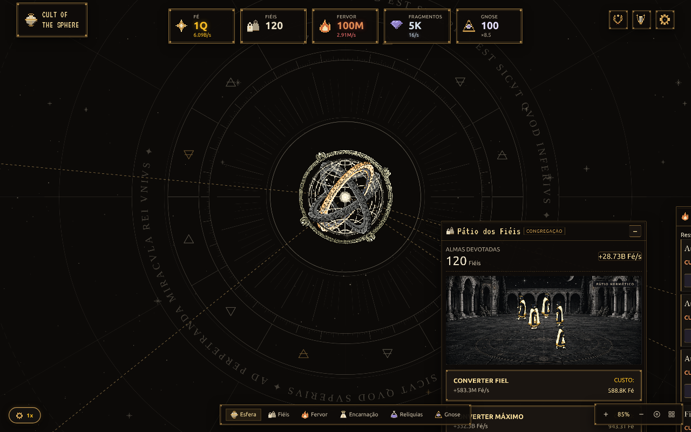
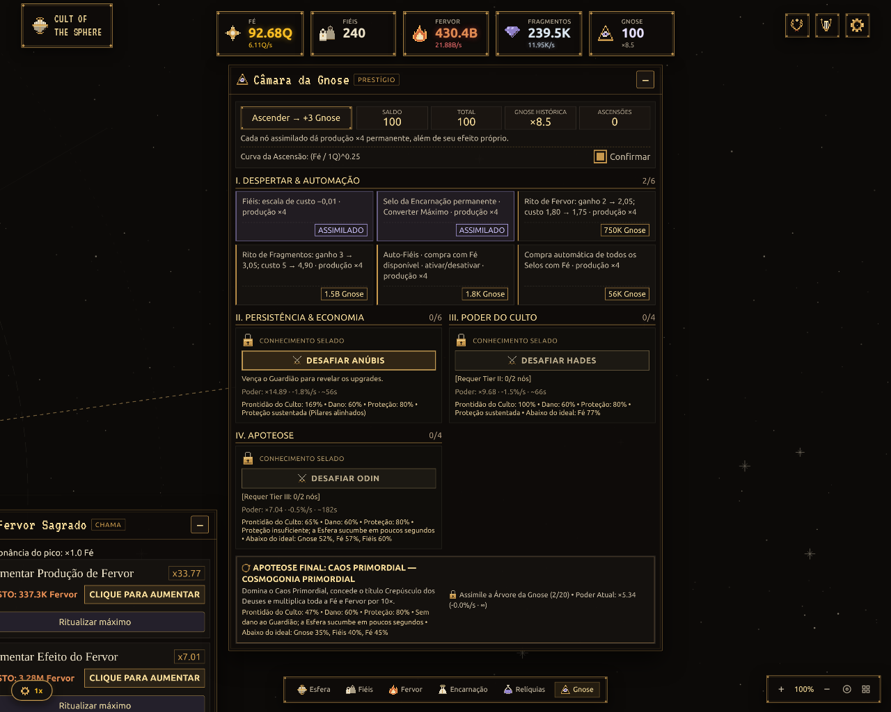
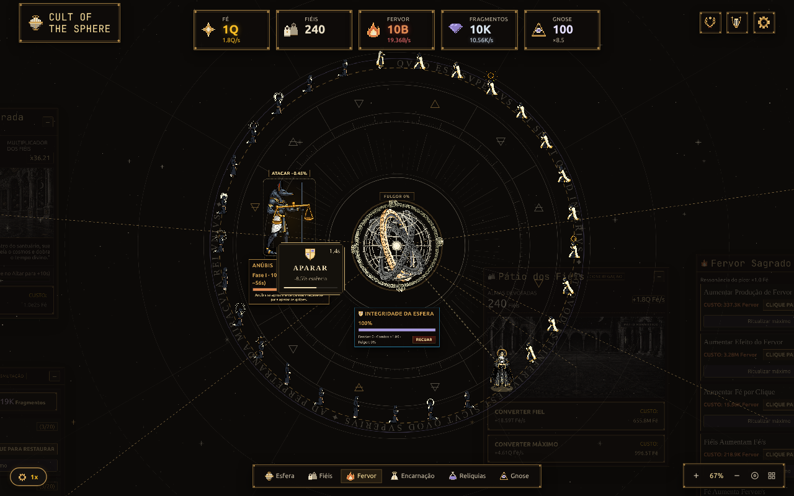

# Cult of the Sphere — Game Design Document

**Estado:** jogo implementado no workspace · **Versão:** 0.9.1 · **Revisão:** 06/11/2026
**Gênero:** idle / incremental / clicker · **Plataforma:** navegador desktop e mobile
**Tecnologia:** TypeScript, Vite, Canvas 2D e CSS

## Visão e fantasia

O jogador é **a Esfera**, uma divindade cujo centro está em toda parte e cuja circunferência não está em lugar nenhum. Tudo é Mente: os deuses existem enquanto alguém pensa neles. O culto recomeça com uma unidade de Fé, sem seguidores, e cresce até confrontar os Guardiões que dominam os panteões.

A jornada transforma atenção em devoção, devoção em produção e conhecimento em permanência. A inspiração incremental é DodecaDragons; a identidade visual combina gravuras herméticas, cosmografia renascentista e sprites animados sobre um fundo astral escuro.

## Pilares do design

1. **Sistemas conectados.** Fé, Fiéis, Fervor, Fragmentos, Encarnação e Gnose fortalecem uns aos outros. Combate também exige desenvolver o conjunto.
2. **Reconstrução com permanência explícita.** Ascender reinicia a economia do ciclo; nós, conquistas e vitórias mantêm o avanço permanente. Preservações adicionais dependem das compras de Gnose.
3. **Um santuário espacial.** Altares habitam um tabuleiro com pan e zoom. A navegação rápida leva aos sistemas e a câmera acompanha a preparação dos duelos.
4. **Ação e automação.** Cliques, milagres e aparos oferecem participação ativa. Automações compradas reduzem tarefas repetitivas e continuam funcionando durante a produção offline.
5. **Regras visíveis.** Custos, taxas, efeitos e prontidão orientam a próxima decisão. A duração da campanha é medida por simulação reproduzível e não é uma promessa fixa.

## Jornada do culto

| Etapa | Acesso | Papel |
| --- | --- | --- |
| Primeiro sussurro | Início | Tocar a Esfera e converter o primeiro Fiel Devoto. |
| Corpo e chama | Selo da Encarnação: 200 Fé | Manifestar o Avatar, produzir Fervor e carregar Bênção. |
| Liturgia | Selo do Fervor: 5.000 Fé | Investir Fervor em Ritos. |
| Espólio dos deuses | Selo das Relíquias: 20 milhões de Fé | Transmutar Fé, produzir Fragmentos e restaurar Relíquias. |
| Dissolução do templo | Selo da Gnose: limiar de 1e15 Fé | Ascender e assimilar nós permanentes. |
| Julgamento | Gnose e tiers avançados | Subjugar Anúbis, Hades, Odin e o Caos Primordial. |

Os três primeiros Selos gastam Fé. O Selo da Gnose exige o saldo mínimo, sem consumi-lo. Cada Selo respeita o anterior.

O ciclo de decisões é: gerar Fé → investir em Fiéis e sistemas → alcançar o próximo marco → ascender quando o ganho de Gnose justificar a reconstrução → assimilar nós → preparar e vencer o próximo Guardião.

## Economia do culto

### Fé e Fiéis

Tocar a Esfera produz Fé; há 5% de chance de crítico com ganho dobrado. O Fiel Devoto custa inicialmente 20 Fé, produz 1 Fé/s antes dos multiplicadores e fica progressivamente mais caro. Relíquias e Gnose reduzem a escala desse custo até o piso configurado.

Converter Máximo abre com 25 Fiéis ou Memória Hermética. Pedidos de milagre aparecem no Pátio; responder concede Fé proporcional ao poder de clique e à produção, sem depender do saldo armazenado.

### Encarnação e Bênção

| Avatar | Custo de evolução em Fé | Multiplicador de Fervor/s |
| --- | --- | --- |
| Neófito | Inicial ao romper o Selo | 1× |
| Consagrado | 2,5 milhões | 100× |
| Ancestral | 250 bilhões | 10.000× |
| Eclipse | 1e25; 1e20 com Gnosis Suprema | 1e8× |
| Solar | 1e30; exige Gnosis Suprema | 1e15× |

O estágio também fortalece os Fiéis e o combate. Cada acionamento do Altar acrescenta 10 segundos de **Bênção 2× Fé/s**, até 60 segundos. Vigília Perpétua a mantém ativa com Encarnação aberta.

### Fervor e Ritos

Fervor começa a ser gerado ao abrir Encarnação. O maior saldo de Fervor do ciclo fortalece a produção; gastar em Ritos conserva a força já alcançada.

Há seis Ritos: produção de Fervor, efeito do Fervor, Fé por clique, Fiéis aumentando Fé/s, Fé aumentando Fervor/s e ganho de Fragmentos. O último exige a Pena Solar de Fênix. Níveis não têm teto fixo; custos crescem exponencialmente. Os nós de Gnose ajustam bases e escalas dessas fórmulas.

### Fragmentos e Relíquias

Transmutar consome toda a Fé atual, concede Fragmentos e inicia um cooldown de 3 segundos. Mantém Fiéis, Fervor, Ritos e Avatar. O Selo das Relíquias também abre produção passiva de Fragmentos.

| Relíquia | Função | Nível máximo |
| --- | --- | --- |
| Cornucópia de Amalteia | Amplia Fé/s. | 20 |
| Tocha de Prometeu | Amplia Fervor/s. | 20 |
| Pena Solar de Fênix | Multiplica Fervor e libera o sexto Rito. | 1 |
| Cajado de Hermes | Reduz a escala do custo dos Fiéis. | 5 |
| Anel Divino de Draupnir | Gera uma fração da Transmutação por segundo, sem gastar Fé. | 1 |
| Arca da Aliança Cósmica | Multiplica Fé/s pelo pico de Fragmentos do ciclo. | 4 |

Custos por nível são fixos. O melhor resultado de Transmutação manual alimenta a geração passiva. Gastar Fragmentos conserva o bônus econômico do pico do ciclo.

## Ascensão e permanência

A Ascensão Gnóstica exige acesso à Gnose e pelo menos 1e15 Fé. O ganho é `floor((Fé / 1e15)^expoente)`, com expoente 0,25 ou 0,28 com Olho de Trismegisto. Não é permitida durante combate.

A Câmara da Gnose mostra quanta Fé falta para a próxima Gnose. A primeira Ascensão pede confirmação, listando o que se perde e o que se mantém; depois disso a confirmação fica desligada e pode ser reativada pela opção **Confirmar Ascensão**.

| Reinicia | Permanece |
| --- | --- |
| Fiéis, Fervor, Ritos e Avatar. | Saldo e histórico de Gnose, nós assimilados. |
| Fragmentos, melhor Transmutação e picos do ciclo. | Conquistas, vitórias, melhores tempos de duelo e históricos de recursos. |
| Relíquias sem Cripta Eterna. | Relíquias com Cripta Eterna. |
| Selos de Fervor e Relíquias; Encarnação sem Memória Hermética. | Acesso à Gnose; Encarnação com Memória Hermética. |
| Fé atual: 1, ou 1.000 com Emanação Primordial. | Preferências de automação. |

Históricos permanentes participam do combate. Os bônus econômicos de Fervor e Arca usam os picos do ciclo, que zeram ao ascender.

### Árvore Hermética

São **20 nós em quatro tiers (6 / 6 / 4 / 4)**. Cada nó é comprado uma vez, exige seus pré-requisitos e permanece após Ascensões. Além do efeito próprio, cada assimilação multiplica Fé, Fervor e Fragmentos por ressonância de 4×. O total de Gnose obtido também concede um multiplicador permanente; gastar a moeda não o reduz.

| Tier | Identidade | Abertura |
| --- | --- | --- |
| I — Despertar & Automação | Emanação, Memória, Fiéis automáticos, Selos automáticos, Chama e Alquimia Astrais. | Acesso à Gnose. |
| II — Persistência & Economia | Ritos e Relíquias automáticos, Cripta, sinergia e economia dos Fiéis e Bênção permanente. | Vitória sobre Anúbis. |
| III — Poder do Culto | Coro, ganho de Gnose e refinamentos herméticos. | Vitória sobre Hades. |
| IV — Apoteose | Olho do Infinito, Gnosis Suprema, Fogo Empíreo e Opus Perfeito. | Vitória sobre Odin. |

Cada nó exibe nome e efeito em linguagem simples; os valores exatos ficam na opção **Nerds** das configurações. Os custos da Gnose foram comprimidos para encurtar a campanha, com reduções proporcionalmente maiores nos nós mais caros. Os preços acima de 1.000 Gnose usam dois algarismos significativos para manter as metas legíveis. O catálogo completo, custos e pré-requisitos estão em [FormulasJogo.md](FormulasJogo.md#8-gnose-e-todos-os-upgrades) e [src/config/gnose.ts](src/config/gnose.ts).

### Automações

Auto-Fiéis, Auto-Ritos, Auto-Relíquias e Auto-Transmutação têm controles independentes. As compras automáticas operam em ciclos de um segundo e validam desbloqueios e saldos.

Auto-Fiéis compra com toda a Fé disponível; por isso o controle permite pausá-lo para guardar Fé. Auto-Ritos escolhe retorno marginal por custo, com até 50 níveis por Rito a cada ciclo; Auto-Relíquias prioriza a primeira Fênix e depois o retorno das compras. Olho do Infinito permite Fiéis e Ritos automáticos sem gasto, mas Relíquias continuam custando Fragmentos. Ruptura Automática reabre Selos elegíveis na ordem, com a cobrança normal dos três primeiros.

## Guardiões e proteção da Esfera

| Guardião | Liberação do desafio | Vitória |
| --- | --- | --- |
| Anúbis — O Pesador de Almas | Acesso à Gnose. | Tier II e 1,5× Fé/Fervor. |
| Hades — O Senhor do Submundo | Tier II aberto e dois nós desse tier. | Tier III e mais 1,5× Fé/Fervor. |
| Odin — O Pai de Todos da Árvore Cósmica | Tier III aberto e dois nós desse tier. | Tier IV e mais 1,5× Fé/Fervor. |
| Caos Primordial — O Vazio Antes da Criação | Árvore completa, com 20 nós. | Mais 10× Fé/Fervor e conquista Crepúsculo dos Deuses. |

Os multiplicadores de vitória se acumulam e também afetam Fé por clique. IDs antigos de Hades e Caos são mantidos no save por compatibilidade.

### Preparação e prontidão

Cada Guardião tem metas próprias de Fé, Fiéis, Fervor e Ritos, Fragmentos e Relíquias, estágio do Avatar e Gnose/nós. A prontidão é a **média geométrica dos seis pilares**, cada um limitado a 200%. Um pilar zerado zera a prontidão; acumular apenas outro recurso não substitui sua ausência. Conquistas aumentam o poder de ataque e a defesa.

- **Menos de 60%:** nenhum dano ao boss, incluindo passivo, crítico, aparos, Fulgor e bônus de ataques especiais.
- **De 60% até menos de 80%:** ataques causam dano, mas a proteção é insuficiente. A pressão drena pelo menos 25 pontos de integridade por segundo e qualquer erro de aparo é fatal.
- **A partir de 80%:** a proteção usa mitigação de todos os sistemas do culto. Dano e resistência continuam escalando com o desenvolvimento, até seus limites.

A Câmara da Gnose mostra a prontidão e os pilares a fortalecer do Guardião que já pode ser desafiado; os demais mostram só o requisito que falta. A arena avisa sobre dano bloqueado e colapso da proteção. As metas numéricas e coeficientes estão na [referência de combate](FormulasJogo.md#11-bosses-e-combate).

### Preparação cênica e ações

A Encarnação vai ao Pátio, reúne os Fiéis e conduz a procissão ao círculo. O Guardião chega depois. Não há dano, pressão ou novas fendas durante a preparação; a luta começa quando ele alcança o ponto de combate.

1. **Atacar o Guardião:** até cinco pulsos de dano por segundo simulado, com cooldown de 0,2 s. Há 5% de chance de crítico dobrado. Cliques continuam gerando Fé.
2. **Aparar:** clicar nos cartões antes de expirarem bloqueia o golpe e dá 25 pontos de carga. O aparo não causa dano ao Guardião nem cura a Esfera. O combo conta os aparos seguidos e zera ao errar; é apenas informativo.
3. **Fulgor Divino:** com carga 100, o botão sobre a Esfera dispara um ataque e esvazia a carga. Cliques de combate acrescentam 8 pontos. O disparo exige prontidão de ataque e não cura.
4. **Milagre dos Fiéis na roda:** pedido de 1,5 segundo que recupera até 10 pontos de integridade. É a fonte de cura do combate.

A Esfera começa com 100 de integridade e sofre pressão contínua, além das perdas por golpes não aparados. Não há contagem regressiva de duelo.

### Tela da luta

Durante o duelo, os menus, as linhas que os ligam à Esfera e a barra de navegação inferior ficam ocultos; voltam ao fim da luta. O Pátio dos Fiéis é a exceção: continua visível enquanto a Encarnação reúne os Fiéis, some aos poucos quando a procissão parte e reaparece no início do retorno após a vitória. Os cartões de aparar surgem em um arco ao redor da Esfera, do lado oposto ao Guardião, sem cobrir o alvo dos cliques nem as barras de vida. Essas barras e os cartões acompanham o zoom para continuar legíveis com a câmera afastada.

As barras do Guardião e da Esfera mantêm um rastro do dano recente, que encolhe depois de um instante. A barra do Guardião mostra a fase, a vida e o tempo estimado de vitória só com dano passivo. Os números de dano por golpe são discretos; aparo, Fulgor e milagre têm destaque maior.

### Fases e assinaturas

A fase II começa em até 60% do HP do boss e causa uma onda de 15 pontos de dano à Esfera. A fase III começa em até 25% e causa mais 30. As ondas podem matar; atravessar ambas de uma vez soma os danos. Elas dissipam fendas antigas e garantem um milagre se não houver outro ativo. Intervalos e janelas de reação ficam menores.

Nas fases avançadas, ataques comuns alternam com a assinatura do Guardião:

| Guardião | Ataque especial |
| --- | --- |
| Anúbis | Dois cartões **PESAR**, cada um com um peso. Escolher o maior bloqueia o ataque; escolher o menor causa o dobro do dano de um erro, ou o triplo se o maior já tiver sido escolhido. Deixar expirar sem escolher causa dano normal. |
| Hades | Duas correntes; enquanto restar uma, o dano de clique cai pela metade. Uma corrente não aparada causa metade do dano de um erro. |
| Odin | Corvo com janela de resposta menor; um aparo cedo adia em 1,4 s o ataque seguinte. |
| Caos Primordial | Três selos em arco ao redor da Esfera; cada selo não aparado causa 40% do dano de um erro. |

Com proteção insuficiente, qualquer erro é fatal, sem essas reduções. O dano passivo é limitado a 1,8% do HP máximo/s e o clique normal a 0,45% antes do crítico; o Fulgor causa de cerca de 5% a 12%, conforme a prontidão. Todos respeitam o limiar mínimo de ataque.

### Resultado e revanche

HP do boss em zero concede vitória e recompensa permanente. Integridade da Esfera em zero encerra em derrota; na campanha aplica maldição de 20 segundos, reduzindo Fé/s e Fervor/s em 25%. Recuar não aplica maldição. A interface mostra um breve clímax visual. Na vitória, a Encarnação conduz os Fiéis de volta ao Pátio antes de retornar ao altar; na derrota, um aviso indica a prontidão e os dois pilares mais fracos.

**Relembrar Duelo** repete Guardiões já subjugados, sem recompensas duplicadas nem maldição por derrota. Vitórias registram o melhor tempo. A conclusão de campanha usada pelo benchmark exige os vinte nós e o Caos Primordial derrotado. Não há sistema de New Game+ implementado.

## Conquistas, salvamento e ausência

O Grimório reúne vinte conquistas de cliques, Fiéis, produção, Gnose e vitória final. Concedem bônus de clique, produção, multiplicador global ou desconto de Fiéis, conforme o catálogo.

O progresso é salvo no navegador a cada 20 segundos, ao ocultar a aba e ao fechar, com backup e exportação/importação Base64. Uma batalha ativa é transitória e não é retomada de um save.

A **Vigília Sagrada** reproduz até 24 horas de ausência com o mesmo integrador da produção online, em passos de até 0,1 segundo. Inclui automações adquiridas, Bênção e maldição; não executa combate, cliques, coleta de milagres, evolução manual de Avatar ou Ascensão. O período é creditado uma única vez e o excesso acima de 24 horas é descartado. O resumo dos ganhos só aparece depois de pelo menos um minuto fora do jogo.

## Interface, arte e áudio

O tabuleiro usa céu escuro, estrelas, inscrições e círculos alquímicos em dourado envelhecido. HUD e molduras mantêm a linguagem astral; Fiéis, Avatares, Esfera e Guardiões usam sprites animados; a Esfera tem cinco formas que acompanham a Encarnação. Canvas desenha as arenas e personagens; painéis HTML apresentam compras, fórmulas e progressão.

Navegação por arraste, roda/pinça e atalhos inferiores. Os cards podem ser movidos, inclusive acima e abaixo da Esfera, e minimizados; Relíquias, Encarnação e Gnose minimizam sozinhos ao serem concluídos. A câmera acompanha procissão, chegada do boss e arena.

O onboarding apresenta os primeiros passos. Depois, um tutorial explica cada mecânica ao ser liberada, separando lore e instrução; os Guardiões têm tutorial próprio após a primeira Ascensão.

As notificações ficam reservadas a marcos e confirmações: conquistas, evolução da Encarnação, resultado de duelos, salvamento, exportação, importação e resumo da ausência. Cada uma permanece de 4 a 8 segundos conforme o tamanho do texto, com barra de tempo, e pausa com o mouse em cima.

Há trilha ambiente, música de combate e efeitos sintetizados. As configurações oferecem volume geral, volume dos efeitos, liga/desliga de música e efeitos e vibração; o HUD tem um atalho para a música.

Ao abrir o jogo, a versão atual é comparada à última versão vista neste navegador. Quando são diferentes, inclusive na primeira visita, uma janela mostra o histórico do `CHANGELOG.md`, começando pela versão atual. Fechar pelo botão ou por Escape registra a versão como vista, separadamente do save da partida. **Configurações → Ver novidades** permite reabrir o histórico a qualquer momento.

## Validação e manutenção

`npm test` verifica regras, progressão, persistência, interface e simulação; `npm run build` verifica tipos e produz o build. A pasta `public/` também guarda fontes de arte (conceitos, quadros soltos, prévias e scripts); o build publica apenas os arquivos que o jogo carrega, conforme `src/config/shippedAssets.ts`. O painel de testes (T/F2), disponível em modo de desenvolvimento, oferece velocidade, recursos de teste e benchmark em Web Worker.

A [metodologia do benchmark](docs/progression/README.md) separa regras do jogo de hipóteses de comportamento. Resultados de versões anteriores e propostas substituídas foram retirados da documentação vigente. Novas medições devem registrar versão do código, seed, perfil, horizonte e conclusão real.

Este GDD descreve o estado implementado. Novas propostas e requisitos ficam nas [GitHub Issues](https://github.com/yuhohah/wmdg/issues); valores executáveis têm como fonte os catálogos em `src/config/` e as regras em `src/core/GameState.ts`.
