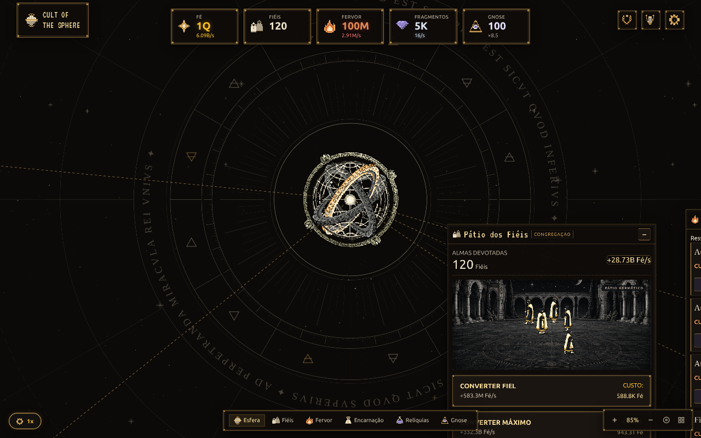
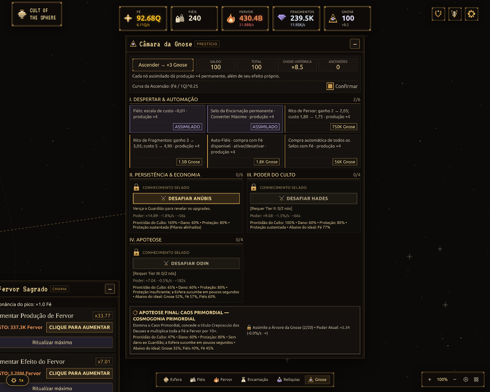
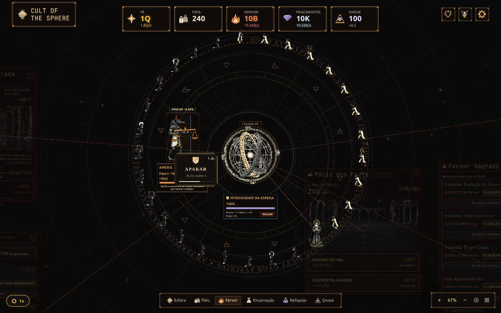

<div align="center">

# ✦ CULT OF THE SPHERE ✦

**Tudo é Mente. Toda devoção alimenta a Esfera.**

Um idle/clicker hermético em um santuário astral navegável.
Converta fiéis, reacenda o Fervor e confronte os deuses que ocuparam seu lugar.

**Versão atual: 0.9.1** · [Changelog](CHANGELOG.md)

[O jogo](#o-santuário) · [Executar](#executar-localmente) · [GDD](GDD.md) · [Fórmulas](FormulasJogo.md) · [Documentação](docs/README.md)



*Capturas da interface real, com uma partida de demonstração preparada para mostrar os sistemas.*

</div>

## O santuário

Você é **a Esfera**, a divindade cujo centro está em toda parte e cuja circunferência não está em lugar nenhum. Esquecida pelos homens, desperta de uma centelha de pensamento. Cada clique canaliza **Fé**; cada Fiel Devoto mantém o culto vivo.

O tabuleiro reúne altares e câmaras em um céu de obsidiana, com gravuras herméticas, diagramas astronômicos, bordas douradas e personagens animados. Arraste o cenário, aproxime com o zoom ou use a navegação inferior para visitar cada sistema.

| Caminho do culto | O que muda |
| --- | --- |
| **Fé & Fiéis** | Cliques, produção passiva, conversões e pedidos de milagre. |
| **Encarnação** | Cinco Avatares, geração de Fervor e Bênção temporária de 2× Fé/s. |
| **Fervor** | Seis Ritos que fortalecem produção, cliques, Fiéis e Fragmentos. |
| **Opus Magnum** | Transmute Fé em Fragmentos e restaure seis Relíquias. |
| **Gnose** | Ascenda, reconstrua o culto e assimile vinte nós permanentes. |
| **Guardiões** | Enfrente Anúbis, Hades, Odin e o Caos Primordial no próprio tabuleiro. |

Os Selos abrem essas camadas em sequência: **200 Fé → 5 mil Fé → 20 milhões de Fé → 1e15 Fé**. O último reconhece o limiar sem cobrar o saldo. Gastar Fervor ou Fragmentos mantém a força do pico alcançado no ciclo; a Ascensão reinicia esses picos.

## A Árvore Hermética



A Ascensão troca a economia atual por **Gnose**. Nós assimilados, conquistas e vitórias sobrevivem aos reinícios. As compras permanentes abrem automações independentes, preservação de Relíquias e melhorias nas fórmulas. Cada nó também concede ressonância de produção.

O que se perde e o que permanece está descrito no [GDD](GDD.md#ascensão-e-permanência) e na [referência matemática](FormulasJogo.md#12-ascensão-e-persistência).

## O julgamento dos deuses



A Encarnação reúne os Fiéis em um círculo antes da chegada do Guardião. O combate começa quando ele alcança a arena: ataque o boss, **apare** os golpes, carregue o **Fulgor Divino** e responda aos milagres que recuperam a integridade da Esfera.

A força do culto depende de **Fé, Fiéis, Fervor, Relíquias, Encarnação e Gnose**, com bônus de conquistas. A prontidão combina os seis pilares pela média geométrica, em relação às metas de cada Guardião.

- **Abaixo de 60%:** cliques, dano passivo, fendas e Fulgor não causam dano.
- **Abaixo de 80%:** um golpe não aparado destrói a proteção; a pressão contínua também leva a Esfera ao colapso em poucos segundos.
- **Com o culto preparado:** os recursos ampliam o dano e reduzem as perdas de integridade, respeitando os limites do combate.

Vitórias liberam os próximos tiers. Depois, **Relembrar Duelo** permite revanches e registra o melhor tempo, sem repetir recompensas.

## Executar localmente

Requer **Node.js 22.12+ (22.x) ou 24.x**, conforme as dependências instaladas, ou o ambiente Nix do projeto.

```bash
npm ci
npm run dev
```

Abra o endereço informado pelo Vite, normalmente `http://localhost:5173`.

| Comando | Uso |
| --- | --- |
| `npm test` | Executa os testes com Vitest. |
| `npm run build` | Verifica TypeScript e gera `dist/`. |
| `npm run preview` | Serve o build de produção localmente. |
| `npm run benchmark -- --seed=42 --hours=24` | Simula os perfis de progressão com horizonte explícito. |

Com Nix:

```bash
nix-shell
npm ci
npm run dev
```

O painel de desenvolvimento abre com **F2** em ambiente de desenvolvimento; oferece recursos de teste, velocidade e benchmark em Web Worker.

## Persistência e controles

- Salvamento local automático a cada 20 segundos, ao ocultar a aba e ao sair, com backup.
- Exportação/importação do progresso em Base64 e reinício nas Configurações.
- Produção durante ausência de até **24 horas**, incluindo automações já adquiridas. A recuperação ocorre em lotes para manter a interface responsiva; o estado calculado é salvo por inteiro antes de substituir o progresso ativo. Combates não continuam offline.
- Arraste para navegar; roda do mouse ou pinça para zoom. Atalhos inferiores focam os altares.
- Áudio ambiente e efeitos, com controles na interface; guia contextual para os primeiros passos.
- Novidades exibidas ao abrir uma versão diferente da última vista neste navegador; histórico acessível em **Configurações → Ver novidades**.

## Por dentro do projeto

```text
src/
├── core/          Estado, regras, loop e eventos
├── config/        Catálogos, custos e constantes de balanceamento
├── features/      Sistemas do culto e combate dos Guardiões
├── systems/       Cálculos, persistência, tempo offline e áudio
├── ui/            Tabuleiro, arenas, HUD e ferramentas de desenvolvimento
├── styles/        Estilos da interface
└── benchmark/     Simulação de campanhas, perfis e relatórios
public/assets/     Artes, sprites, fontes e trilha usadas pelo jogo
docs/              Guias, metodologia e capturas da interface
```

A documentação acompanha o comportamento implementado. [GDD](GDD.md) explica o design, [FormulasJogo.md](FormulasJogo.md) detalha os cálculos e [GLOSSARY.md](GLOSSARY.md) define os termos. A [metodologia de progressão](docs/progression/README.md) explica como produzir novas medições; durações de versões anteriores não representam o balanceamento atual.
